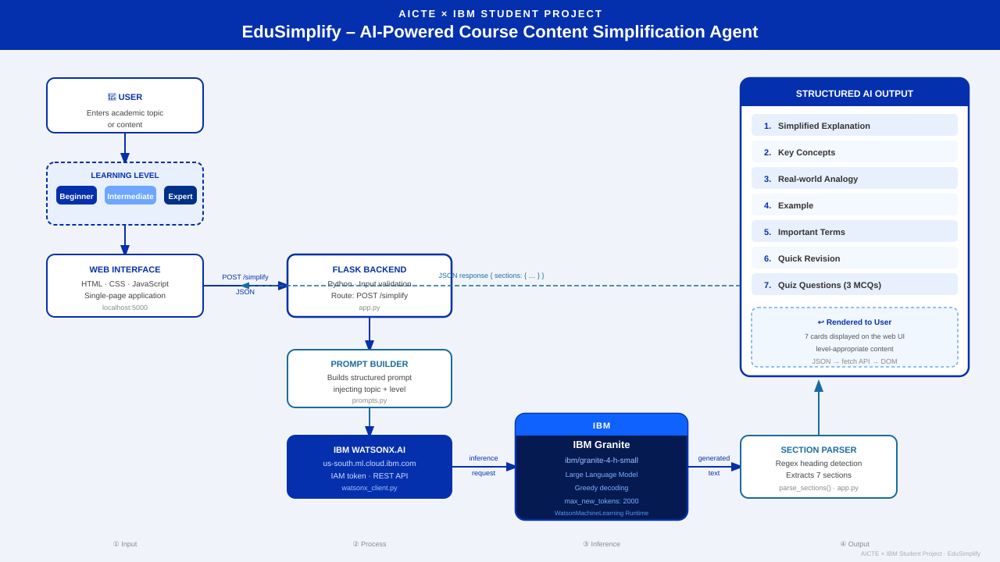

<div align="center">

# ⚡ EduSimplify
### AI-Powered Course Content Simplification Agent

*AICTE × IBM University Engagement Program 2026 · Problem Statement PS19*

[](https://python.org)
[](https://flask.palletsprojects.com)
[](https://www.ibm.com/watsonx)
[](https://www.ibm.com/granite)
[](LICENSE)

**Simplify any academic topic into 7 structured learning sections — powered by IBM Granite on watsonx.ai**

[🚀 Quick Start](#-quick-start) · [✨ Features](#-features) · [🏗️ Architecture](#️-architecture) · [🧪 Tests](#-tests) · [🔮 Future Scope](#-future-scope)

</div>

---

## 📖 About

**EduSimplify** is a full-stack educational AI agent that bridges the academic comprehension gap. Students submit any topic or textbook excerpt, choose their proficiency level, and receive a structured, pedagogically rich learning module — generated in real-time by **IBM Granite** (`ibm/granite-4-h-small`) on **IBM watsonx.ai**.

> Traditional education is one-size-fits-all. EduSimplify adapts to *you*.

---

## ✨ Features

<details open>
<summary><b>🎓 3 Adaptive Learning Levels</b></summary>

| Level | Audience | Style |
|---|---|---|
| 🌱 **Beginner** | No prior knowledge | Simple words, friendly analogies, everyday metaphors |
| 📘 **Intermediate** | Basic familiarity | Academic tone, standard terminology, applied examples |
| 🎓 **Expert** | Advanced / Professional | Rigorous depth, formal definitions, theoretical nuance |

</details>

<details open>
<summary><b>📚 7 Structured Output Sections</b></summary>

| # | Section | Description |
|---|---|---|
| 1 | 💡 **Simplified Explanation** | Core concept broken down for your level |
| 2 | 🔑 **Key Concepts** | Bulleted foundational pillars |
| 3 | 🌍 **Real-world Analogy** | Relatable everyday scenario |
| 4 | 📝 **Example** | Concrete walk-through or application |
| 5 | 📖 **Important Terms** | Key terms clearly defined |
| 6 | ⚡ **Quick Revision** | High-yield bullets for exam prep |
| 7 | 🧠 **Quiz Questions** | 3 MCQs with answer keys |

</details>

<details>
<summary><b>🛡️ Robust Guardrails</b></summary>

- Input validation: 1–2000 character limit with live counter
- Level validation on both client and server
- Multi-strategy regex fallback parsing (numbered, plain, markdown headings)
- Clear human-readable error messages for all failure cases

</details>

---

## 🏗️ Architecture




<details>
<summary><b>📡 Data Flow Pipeline</b></summary>

```
Browser  →  Flask /simplify  →  prompts.py  →  IBM IAM (token)
                                                      ↓
                                            watsonx.ai Granite
                                                      ↓
                               parse_sections()  ←  raw text
                                      ↓
                               JSON response  →  script.js  →  7 Cards
```

1. **User Input** — Topic + level submitted via browser form
2. **Validation** — Flask validates payload, length, and level
3. **Prompt Build** — `prompts.py` constructs a structured 7-section prompt
4. **IAM Auth** — `watsonx_client.py` exchanges API key for short-lived Bearer token
5. **Inference** — Prompt sent to `ibm/granite-4-h-small` via watsonx.ai REST API
6. **Parsing** — Multi-pattern regex splits raw text into 7 labelled sections
7. **Render** — `script.js` populates result cards in the browser

</details>

---

## 🛠️ Tech Stack

| Layer | Technology | Role |
|---|---|---|
| **Backend** | Python 3.10+ · Flask 3.1 | Routing, validation, parsing |
| **Frontend** | HTML5 · CSS3 · Vanilla JS | Dark-themed responsive UI |
| **AI Model** | IBM Granite `ibm/granite-4-h-small` | Text generation |
| **AI Platform** | IBM watsonx.ai | Model inference infrastructure |
| **Auth** | IBM Cloud IAM OAuth 2.0 | Short-lived token exchange |
| **Config** | python-dotenv | Environment variable isolation |
| **Testing** | pytest | Mocked unit & integration tests |

---

## 🚀 Quick Start

### Prerequisites
- Python 3.10+
- IBM Cloud account with watsonx.ai access

### 1 — Clone

```bash
git clone https://github.com/Madansingh7/EduSimplify-Project-AICTE.git
cd EduSimplify-Project-AICTE
```

### 2 — Virtual Environment

```bash
# Windows
python -m venv venv
.\venv\Scripts\Activate.ps1

# macOS / Linux
python3 -m venv venv
source venv/bin/activate
```

### 3 — Install Dependencies

```bash
pip install -r requirements.txt
```

### 4 — Configure Credentials

```bash
# Windows
copy .env.example .env

# macOS / Linux
cp .env.example .env
```

Edit `.env`:

```ini
WATSONX_API_KEY=your_ibm_cloud_api_key_here
WATSONX_PROJECT_ID=your_watsonx_project_id_here
WATSONX_URL=https://us-south.ml.cloud.ibm.com
WATSONX_MODEL_ID=ibm/granite-4-h-small
```

> 🔒 **Never commit `.env` to GitHub** — it's already in `.gitignore`

### 5 — Run

```bash
python app.py
```

Open **[http://localhost:5000](http://localhost:5000)** 🎉

---

## 🧪 Tests

All IBM HTTP calls are fully mocked — no API key needed to run tests.

```bash
# Run all tests
pytest tests/ -v

# Run a specific file
pytest tests/test_app.py -v
pytest tests/test_prompts.py -v
pytest tests/test_watsonx.py -v
```

---

## 📁 Project Structure

```
EduSimplify-Project/
│
├── app.py                  ← Flask app, routes, parse_sections()
├── watsonx_client.py       ← IBM IAM + watsonx.ai API wrapper
├── prompts.py              ← Prompt builder + SECTION_LABELS
├── requirements.txt
│
├── templates/
│   └── index.html          ← Main UI page
│
├── static/
│   ├── style.css           ← Dark theme styles
│   └── script.js           ← Frontend logic & section renderer
│
├── tests/
│   ├── test_app.py
│   ├── test_watsonx.py
│   └── test_prompts.py
│
├── docs/
│   ├── architecture_diagram.svg
│   └── architecture diagram.png
│
├── .env.example            ← Credential template
└── .gitignore
```

---

## 🔮 Future Scope

| # | Feature | Description |
|---|---|---|
| 1 | 🌐 **Multilingual Support** | Translate output into Hindi, Tamil, Bengali, Telugu |
| 2 | 🔊 **Audio Read-Aloud** | TTS integration for auditory learners |
| 3 | 📄 **Document Ingestion** | Upload PDFs and lecture slides |
| 4 | 🏫 **LMS Integration** | Export to Moodle, Canvas, Google Classroom |

---

## 🤝 IBM watsonx.ai Integration

```
Model    : ibm/granite-4-h-small
Endpoint : POST {WATSONX_URL}/ml/v1/text/generation?version=2023-05-29
Auth     : POST https://iam.cloud.ibm.com/identity/token

Parameters:
  decoding_method  : greedy   → deterministic, consistent output
  max_new_tokens   : 2000     → fits all 7 sections comfortably
  repetition_penalty: 1.1    → prevents looping in bullets
```

---

<div align="center">

**Built by [Madan Singh](https://github.com/Madansingh7)**

*AICTE × IBM University Engagement Program 2026*

[](https://www.ibm.com/granite)
[](https://www.ibm.com/watsonx)

</div>
